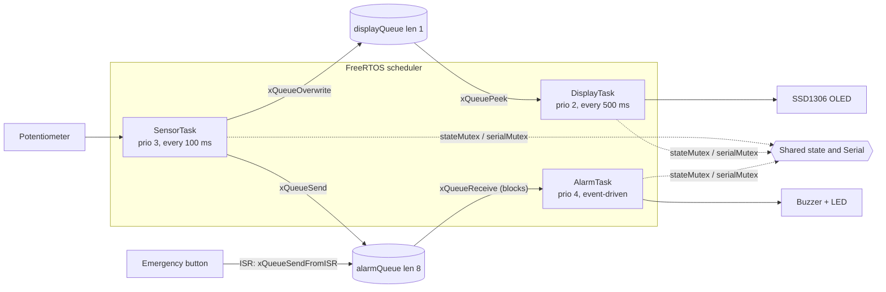

# Multi-Tasking RTOS Firmware Scheduler

A **FreeRTOS-based multitasking firmware** for ESP32 that splits sensor acquisition, local display
updates and emergency alarm handling into three independent tasks, coordinated with queues, mutexes
and an interrupt service routine. Built and verified in the **Wokwi** simulator.

> **Live simulation:** `<ADD YOUR WOKWI SHARE LINK HERE>`


---

## 1. Objective

Run three tasks concurrently under the FreeRTOS scheduler so that the **emergency alarm responds
promptly to critical conditions and is never delayed by sensor acquisition or display updates**.

| Task | Purpose |
|---|---|
| **SensorTask** | Reads the sensor every 100 ms (4-sample average), publishes the reading |
| **DisplayTask** | Shows the live reading and alarm status on the OLED every 500 ms |
| **AlarmTask** | Monitors critical conditions and drives the buzzer and LED |

## 2. Hardware (simulated in Wokwi)

| Component | ESP32 pin | Role |
|---|---|---|
| ESP32 DevKit | - | Microcontroller (FreeRTOS built into the Arduino-ESP32 core) |
| Potentiometer | GPIO34 (ADC1) | Simulated temperature sensor, 0-4095 maps to 0-100 C |
| SSD1306 OLED 128x64 | SDA GPIO21, SCL GPIO22 | Local display |
| Buzzer | GPIO25 | Alarm output |
| Red LED + 220 ohm | GPIO26 | Alarm output |
| Push-button | GPIO27 (pull-up, to GND) | Manual emergency trigger (ISR) |

## 3. System architecture


<details>
<summary>Editable Mermaid version</summary>


</details>

## 4. Task creation, priorities and scheduling strategy

```cpp
// firmware/sketch.ino  (setup)
#define PRIO_DISPLAY 2
#define PRIO_SENSOR  3
#define PRIO_ALARM   4          // highest: safety-critical

xTaskCreatePinnedToCore(alarmTask,   "AlarmTask",   STACK_ALARM,   NULL, PRIO_ALARM,   &hAlarm,   APP_CORE);
xTaskCreatePinnedToCore(sensorTask,  "SensorTask",  STACK_SENSOR,  NULL, PRIO_SENSOR,  &hSensor,  APP_CORE);
xTaskCreatePinnedToCore(displayTask, "DisplayTask", STACK_DISPLAY, NULL, PRIO_DISPLAY, &hDisplay, APP_CORE);
```

| Task | Priority | Execution model | Why this priority |
|---|---|---|---|
| AlarmTask | **4 (highest)** | Event-driven: blocks on `alarmQueue` with `portMAX_DELAY`; while an alarm is active it wakes every 150 ms to blink | Safety-critical, must preempt everything |
| SensorTask | 3 | Periodic, 100 ms, `vTaskDelayUntil` (no drift) | Feeds data to the alarm, so it must run before display |
| DisplayTask | 2 (lowest) | Periodic, 500 ms, `vTaskDelayUntil` | Cosmetic, can be preempted |

**Scheduling strategy.** FreeRTOS preemptive, fixed-priority scheduling with time slicing. All three
tasks are pinned to one core, so priority preemption is clearly visible.

* When idle, AlarmTask sleeps in `xQueueReceive` and uses no CPU. The moment SensorTask (or the button
  ISR) posts an event, AlarmTask becomes ready and **preempts** SensorTask and DisplayTask immediately.
* Sensor sampling (100 ms) is 5x faster than the display (500 ms), so a threshold crossing is seen within
  one sensor period.
* No busy-wait loops. Every task blocks (`vTaskDelayUntil` or a queue wait), leaving the CPU free.
* The alarm outputs are switched **before** logging or updating shared state, so slow operations
  (Serial, mutex) never delay the safety action.
* Alarm uses **hysteresis**: ON at >= 70 C, OFF at <= 65 C, so it does not chatter around the threshold.

## 5. Inter-task communication and race-condition prevention

| Mechanism | Used for | Why |
|---|---|---|
| `displayQueue`, length 1, `xQueueOverwrite` / `xQueuePeek` | SensorTask -> DisplayTask | Mailbox: sensor never blocks, display always reads the newest value |
| `alarmQueue`, length 8 | SensorTask and button ISR -> AlarmTask | Single blocking point for the alarm, supports readings and manual events |
| `stateMutex` (priority inheritance) | Shared `SystemState_t` | Prevents torn reads and writes; held only for a short struct copy, with bounded timeouts |
| `serialMutex` | Serial port | Log lines from three tasks never interleave |
| `xQueueSendFromISR` + `portYIELD_FROM_ISR` | Emergency button | Wakes AlarmTask immediately from the interrupt, with a 200 ms debounce |
| Single-owner rule | I2C bus and OLED | Only DisplayTask touches the display, so no lock is needed |

## 6. Test results (real Wokwi run, see `docs/serial_output.txt`)

| # | Test | Expected | Result |
|---|---|---|---|
| 1 | Boot | 3 tasks created, scheduler starts | **PASS** - `BOOT: creating tasks (alarm=4 sensor=3 display=2)` at 382 ms, `scheduler running` at 394 ms |
| 2 | Normal operation (0-68 C) | Periodic logs, no alarm | **PASS** - DISPLAY every 500 ms, SENSOR every 1 s, `alarm=off` below 70 C (e.g. 68.5 C at 21.3 s) |
| 3 | Temperature rises to >= 70 C | Alarm activates promptly | **PASS** - activated at 22984 ms (84.5 C), 27683 ms (100.0 C) and 44183 ms (70.8 C, right at the threshold); each with `response latency=0 ms` |
| 4 | Temperature falls to <= 65 C | Alarm clears | **PASS** - cleared at 24983 ms (64.0 C) and 40183 ms (58.2 C) |
| 5 | Hysteresis | No chatter between 65 C and 70 C | **PASS** - at 29283 ms the sensor read 68.9 C and the alarm stayed ON |
| 6 | Concurrency | Sensor and display keep running while alarm is active | **PASS** - SENSOR and DISPLAY logs continue at their normal periods throughout every alarm interval |
| 7 | Stability | No reset, no overflow, no dropped events | **PASS** - ~61 s run with no reboot, no `WARN` lines; minimum free stack: sensor 1056 B, display 2100 B, alarm 1096 B |
| 8 | Manual emergency button (ISR) | `manual emergency button -> SET / CLEARED` | **Pending** - not captured in the log above. Press the red button in Wokwi and append the log to `docs/serial_output.txt` |

`response latency` is measured from the moment the sensor sample is taken to the moment the alarm
outputs are switched. It reads 0 ms because it is below the 1 ms FreeRTOS tick resolution.

### Screenshots

| Normal operation | Alarm active (high temperature) | Alarm activated at 70.8 C |
|---|---|---|
|  |  |  |

Each screenshot shows the circuit, the OLED, the source code and the live serial output, which
demonstrates the tasks running concurrently.

## 7. How to run

1. Open `<ADD YOUR WOKWI SHARE LINK HERE>`, or create a new **ESP32 (Arduino)** project at
   [wokwi.com](https://wokwi.com) and paste in `firmware/sketch.ino`, `firmware/diagram.json` and
   `firmware/libraries.txt` (libraries: *Adafruit SSD1306*, *Adafruit GFX Library*).
2. Press **Start Simulation**.
3. Turn the potentiometer above ~70 % to trigger the alarm, then below ~65 % to clear it.
4. Press the red button to toggle the manual emergency.

## 8. Repository structure

```
.
├── README.md
├── firmware/
│   ├── sketch.ino        # complete source (tasks, queues, mutexes, ISR)
│   ├── diagram.json      # Wokwi circuit
│   └── libraries.txt     # Arduino libraries
└── docs/
    ├── architecture.svg
    ├── serial_output.txt # real serial capture
    └── screenshots/
```

## 9. Assignment checklist

| Requirement | Where |
|---|---|
| FreeRTOS on a supported microcontroller, environment initialised | `firmware/sketch.ino` (ESP32), `setup()` |
| Independent tasks: sensor, display, alarm | `sensorTask`, `displayTask`, `alarmTask` |
| Suitable priorities | Section 4 |
| Queues, mutexes, ISR notification | Section 5 |
| Periodic sensor and display | `vTaskDelayUntil` (100 ms and 500 ms) |
| Prompt emergency response | Event-driven highest-priority AlarmTask, 0 ms latency (Section 6) |
| Race-condition prevention | Section 5 |
| Reliable operation without unnecessary blocking | Tests 6 and 7 |
| Architecture diagram | Section 3 |
| Task creation, priority and sync code | Sections 4 and 5, `firmware/sketch.ino` |
| Screenshots and serial output | Section 6, `docs/` |
| Task purpose and scheduling strategy | Sections 1 and 4 |
| Normal and emergency test results | Section 6 |
